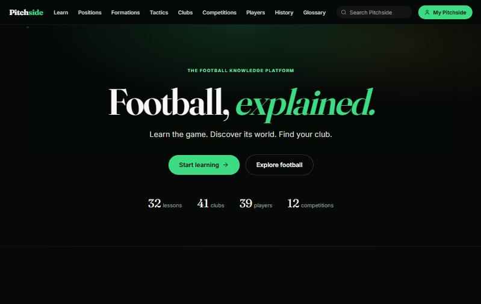
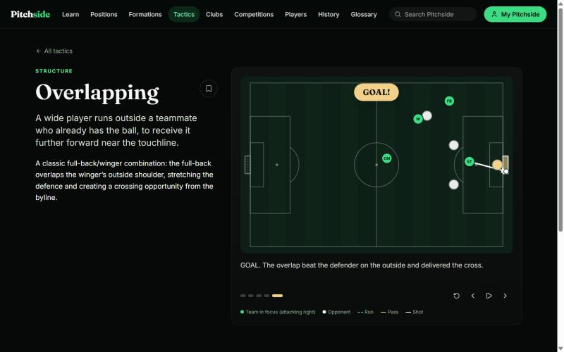
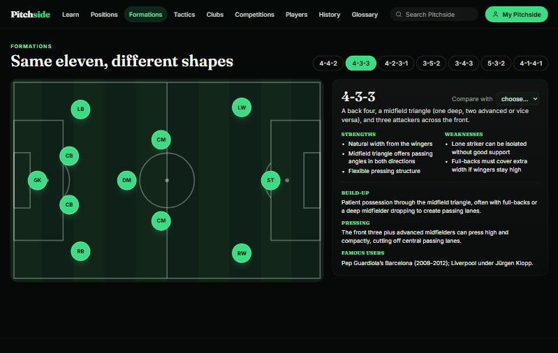
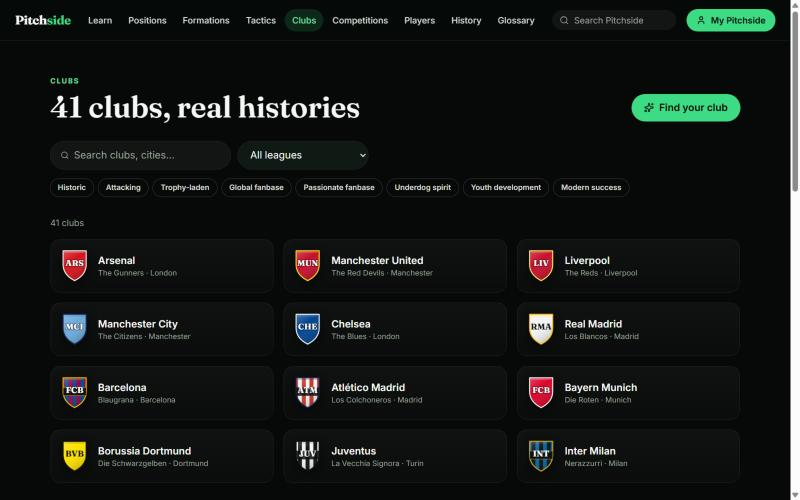
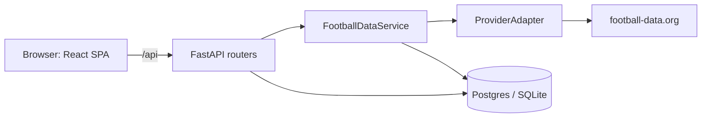

# Pitchside

**Football, explained.** A full-stack learning and discovery platform for football: 32 structured lessons,
animated tactics diagrams, interactive positions and formation tools, and a database of real clubs, players and
competitions, with live fixtures and tables from a pluggable data provider.

> **Live demo:** _add your deployed URL here_ · **API docs:** _`/docs` on the deployed API_



| Animated tactics, each ending in a goal | Interactive formations |
|---|---|
|  |  |



## What it does

- **Learn:** 32 lessons in four levels (basics, rules, tactics, the football world) with scored quizzes, progress
  tracking, bookmarks and an interactive offside simulator.
- **Tactics:** 11 data-driven animated diagrams. A diagram is a few keyframes of player positions; the renderer
  animates between them, draws passes, runs and shots, and every sequence ends in a goal.
- **Positions and formations:** a landscape pitch with 10 positions and 7 formations, including side-by-side comparison.
- **Clubs, players, competitions, history:** 41 clubs (Europe's top leagues, South America, Saudi Arabia, MLS and the
  Indian Super League), 39 players with career timelines, 12 competitions and a 46-event history timeline.
- **Find your club:** a questionnaire that matches clubs on documented traits and shows exactly which traits matched,
  so a recommendation is never a black box.
- **Live data:** fixtures, results and tables for supported competitions, each labelled with its source and age
  ("Updated 12 min ago"), degrading to a plain "not configured" message when no data source is attached.
- **Search** across clubs, players, competitions, tactics, lessons, glossary and history.

## Stack

| | |
|---|---|
| Frontend | React 19, TypeScript, Vite, React Router, Tailwind CSS v4, Framer Motion |
| Backend | Python, FastAPI, async SQLAlchemy 2, Pydantic |
| Database | PostgreSQL (Neon) in production, SQLite locally |
| Auth | bcrypt + JWT (built and tested; the UI is switched off by a feature flag) |
| Quality | pytest (24 tests), a seed-data integrity checker, strict TypeScript, GitHub Actions CI |

## Architecture



Decisions worth noting:

- **Provider abstraction.** Routers never call an external API. `FootballDataService` talks to a `ProviderAdapter`
  interface, normalises the result, and stores it with `source` and `last_updated`. Swapping data providers means
  writing one adapter.
- **Freshness is a first-class idea.** Matches refresh after 30 minutes and standings after 2 hours, on demand. A
  failed fetch backs off instead of retrying on every page view, and the last good data is still served with its real
  timestamp alongside the error.
- **Canonical IDs.** Every entity has a stable slug (`arsenal`, `lionel-messi`) and an `external_ids` map, so provider
  IDs never become the app's identity. Provider team names are matched to clubs by normalised name; unknown teams stay
  unlinked rather than being guessed.
- **Content, entities and user data are separate.** Lessons, glossary and history are seeded rows; positions, formations
  and diagram keyframes are typed modules; accounts, follows and progress live in their own tables. The seed upserts
  content and never touches user tables.
- **Honest data.** Volatile facts carry an "as of" season. Unverifiable fields are left empty, not guessed. Club badges
  are generated from each club's kit pattern because real crests are trademarked.

## Engineering notes

- Tests exercise the live-data pipeline end to end with a fake provider. Writing them exposed a real bug: after a
  provider failure, a database rollback expired the loaded ORM object and the next attribute access crashed the request.
  It is fixed and covered by a regression test.
- `python -m scripts.check_data` verifies every cross-reference in the seed data (club, player, competition, glossary
  and history links; quiz answer ranges) and runs in CI.
- Accessibility: skip link, labelled controls, `aria-pressed` on toggles, keyboard-operable diagrams, and
  `prefers-reduced-motion` respected throughout.
- Performance: route-level code splitting keeps the initial JavaScript at about 133 kB gzipped; the markdown renderer
  only loads on lesson pages.
- Layout checked at 375 px wide with no horizontal scrolling on the 13 main pages.

## Run it locally

```bash
# backend  (http://127.0.0.1:8420)
cd backend
python -m venv venv && source venv/Scripts/activate      # venv/bin/activate on macOS/Linux
pip install -r requirements-dev.txt
python -m app.seed                                       # creates tables and loads content (safe to re-run)
uvicorn app.main:app --port 8420 --reload

# frontend  (http://localhost:5174)
cd frontend
npm install
npm run dev -- --port 5174                               # proxies /api to the backend
```

```bash
cd backend && python -m pytest -q && python -m scripts.check_data
cd frontend && npx tsc -p tsconfig.app.json --noEmit && npm run build
```

## Configuration

Backend (`backend/.env`, see `backend/.env.example`):

| Variable | Purpose |
|---|---|
| `DATABASE_URL` | Empty for local SQLite. For Neon, paste the connection string; it is converted to the asyncpg driver automatically. |
| `JWT_SECRET` | Required with any non-SQLite database. |
| `CORS_ORIGINS` | Allowed browser origins (the deployed frontend URL). |
| `FOOTBALL_API_KEY` | Free key from football-data.org. Without it, live sections say "not configured". |

Frontend (`frontend/.env.example`): `VITE_API_URL` (deployed API origin) and `VITE_ENABLE_ACCOUNTS=true` to show sign-in.

## Deploying

Frontend: any static host. `frontend/vercel.json` rewrites unknown paths to `index.html`. Set `VITE_API_URL`.
Backend: `backend/Dockerfile` runs on Render, Railway or Fly. Set the variables above, then run `python -m app.seed` once.

## Limitations

- Live data is verified against a fake provider in tests; it has not yet been run against the real football-data.org API.
  The free tier covers only some competitions (Europa League, Conference League, Copa América and the ISL show "not available").
- Seed facts were written by hand. Honour counts, current clubs and managers go stale each season; each carries an "as of"
  label and should be re-verified before relying on them.
- Accounts exist in the backend but are off in the UI. No email verification, password reset or auth rate limiting yet.
- No crests, logos or player photos (licensing).
